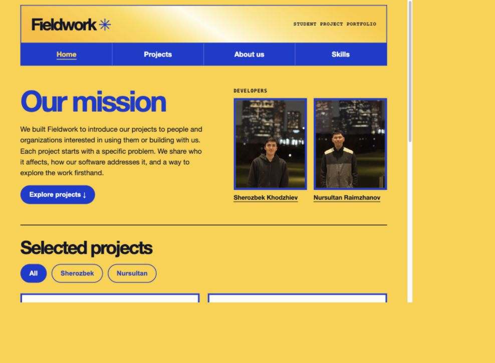

# Fieldwork — Student Project Portfolio

## Description

Fieldwork presents four projects by Sherozbek Khodzhiev and Nursultan Raimzhanov. We built it for our Front-End Web Application Development final so classmates and potential collaborators could see what each application does, who built it, and which problem it addresses. Visitors can explore a village archive (Andarak), a virtual fitting room (PERLA), an AI study reflection tool (LotusGuard), and a personal stylist (Gemi).

## Tech Stack Used

| Technology or tool | Use in Fieldwork |
| --- | --- |
| HTML5 | Page structure, navigation, portraits, the skills table, and embedded project videos |
| CSS3 and Normalize.css | Consistent styling, responsive grids, and layouts for desktop and mobile |
| JavaScript | Project filtering, profile switching, and the active navigation indicator |
| jQuery and SlickNav | The collapsible mobile menu adapted from the Town Hall class exercise |
| GitHub and GitHub Pages | Source repository and public hosting |

## Features

- **Project gallery.** Filter by developer and select **Read more** on any card to open its project page.
- **Project demonstrations.** Watch the PERLA, LotusGuard, and Gemi videos on their pages or follow the direct YouTube links.
- **Developer profiles.** Switch between team members on the About us page to see each person’s portrait, biography, and GitHub profile.
- **Skills in practice.** Follow any row in the skills table to see the project that uses those technologies or capabilities.
- **Responsive navigation.** The desktop navigation highlights the current section and becomes a collapsible menu on phones.

## How to Run the Project

[Open the live portfolio](https://sherozkhodzhiev.github.io/fieldwork-portfolio/)

1. To run a local copy, download and extract the entire source ZIP.
2. Open the extracted project folder and double-click `index.html`. Keep the HTML files, stylesheets, scripts, and `assets` folder together.
3. Select **Explore projects**, choose a developer, and open **Read more** to try the gallery.

The portfolio runs directly in a browser without installation, a server, or an account. Internet access is required for YouTube videos and external GitHub links.

## Screenshots

The homepage introduces both developers beside the mission and leads into the project gallery.

The source ZIP also includes this screenshot at `assets/homepage.jpg` for offline viewing.

## Team Members

| Team member | Contributions and featured work |
| --- | --- |
| Sherozbek Khodzhiev | Defined the portfolio brief, supplied photographs and demo links, and directed revisions to the navigation, gallery, and portraits. His featured projects are Andarak and LotusGuard. |
| Nursultan Raimzhanov | Built and tested PERLA and Gemi. His profile connects visitors to his work on GitHub. |

The portfolio implementation and initial copy were prepared with Codex assistance.

## Challenges & Learning

- **Adapting the class layout.** The Town Hall exercise linked speaker profiles from a directory. Fieldwork applies that pattern to developer profiles and project pages. The same navigation list supplies the desktop tabs and mobile menu, so a change to a link carries across screen sizes.
- **Keeping profile details together.** Each profile stores its portrait, biography, and GitHub link in one JavaScript record. Switching profiles updates all three together and keeps each link paired with the correct person.
- **Supporting offline grading.** Relative file paths and bundled scripts let the extracted ZIP load portraits, switch profiles, and filter projects locally. Embedded videos still need an internet connection.

## Future Improvements

As the gallery grows, a technology filter could help visitors find projects that use a particular tool. Written transcripts alongside the project videos would also let visitors follow each demonstration without audio.
